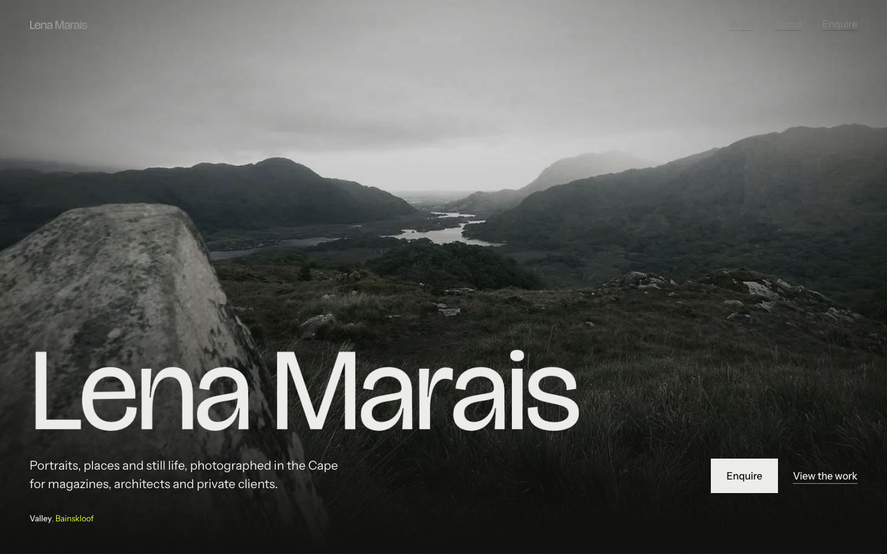
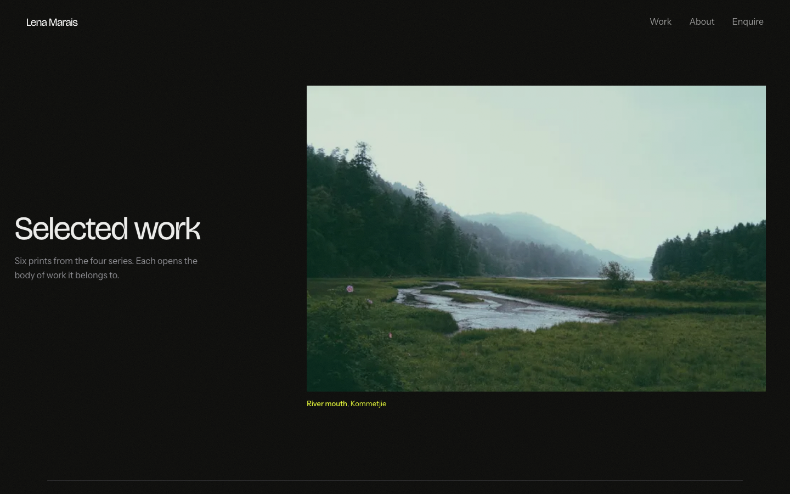
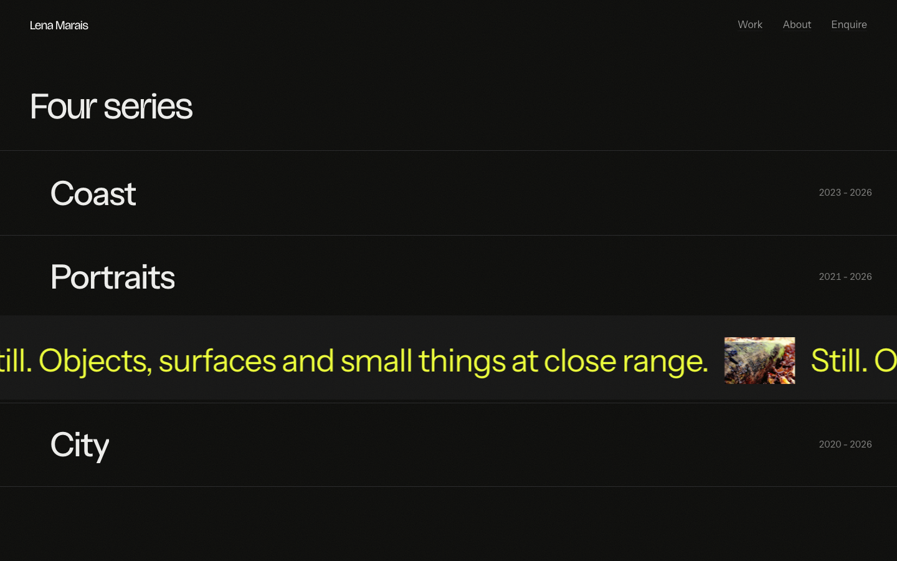
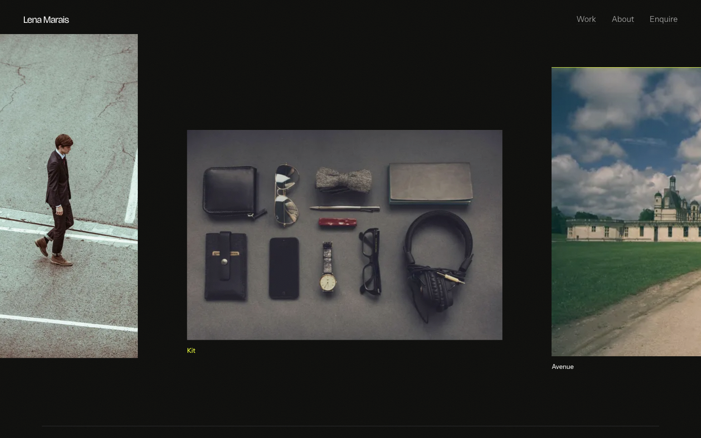
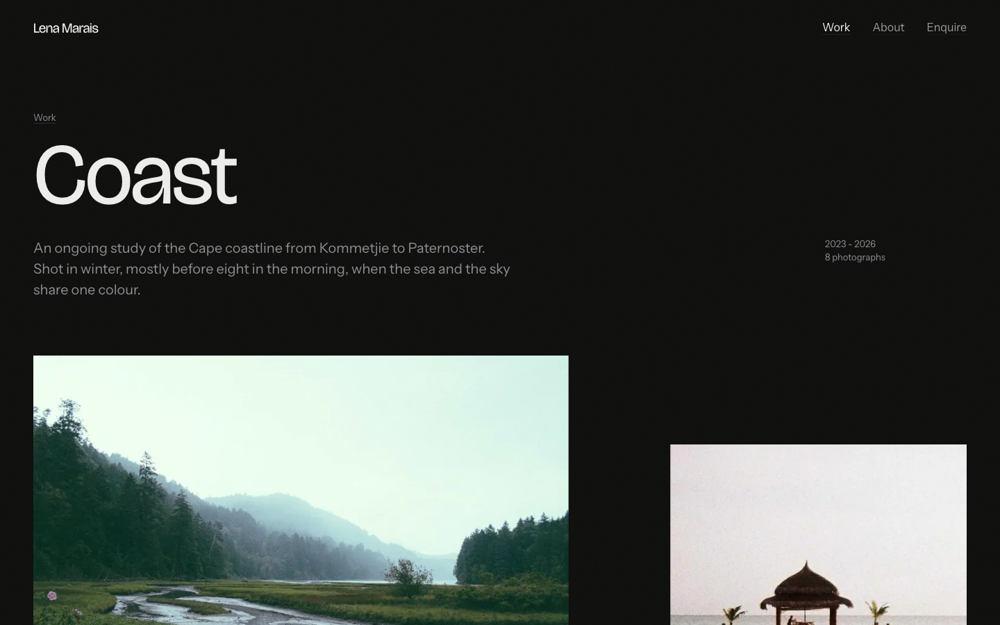
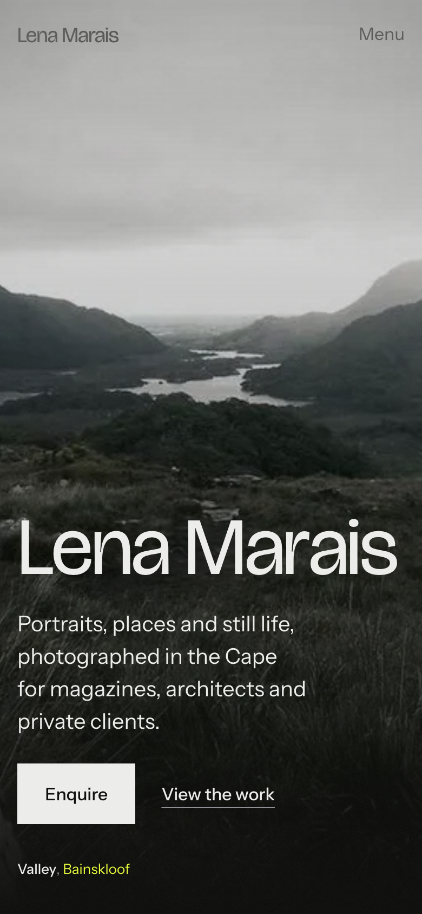

# Lena Marais, photography portfolio

A static portfolio site for a Cape Town photographer. Four series of work, a pinned horizontal pan through selected prints, and a dark "darkroom" theme where the photographs carry the colour.



## Highlights

- **Selected work pan.** The section pins to the top of the viewport and vertical scroll carries six prints sideways. When the last print has passed, the page moves on to the series list.
- **Prints that develop.** The hero fades up like a print in a tray, and each photograph unmasks with a thin exposure line as it enters.
- **Four series.** Coast, Portraits, Still and City, each with its own page, linked from an interactive hover list.
- **Fast by default.** Static output, responsive WebP images, self-hosted fonts and no runtime beyond the small interactive islands.
- **Respects reduced motion.** Smooth scrolling and scroll animation are skipped, and the pan becomes a plain sideways-scrolling strip.

| Selected work, pinned and panning | Four series |
| :--- | :--- |
|  |  |
|  |  |



## Tech stack

| Area | Tools |
| :--- | :--- |
| Framework | [Astro 7](https://astro.build), static output, `astro:assets` image optimisation, `ClientRouter` page transitions |
| Language | TypeScript 6, checked with `@astrojs/check` |
| Interactive UI | React 19 via `@astrojs/react`, used only for small islands (text reveal, magnetic buttons, hover menu, lens) |
| Component sources | [React Bits](https://reactbits.dev) and [Magic UI](https://magicui.design), copied into `src/components` |
| Styling | Tailwind CSS 4 through its Vite plugin, theme tokens as CSS variables in `src/styles/global.css` |
| Type | Bricolage Grotesque (display) and Instrument Sans (body), self-hosted with Fontsource |
| Icons | `astro-icon` with the Phosphor set |
| Scroll and motion | [Lenis](https://lenis.darkroom.engineering) smooth scroll, [GSAP](https://gsap.com) ScrollTrigger for the pin, pan, reveals and parallax, `motion` for the React islands |
| SEO | `@astrojs/sitemap`, canonical and Open Graph tags, JSON-LD `Person` schema |
| Testing and audits | Playwright for screenshots and scroll checks, Lighthouse for performance and SEO |

There is no CMS or database. Content is plain files in the repo.

## Project structure

```text
/
├── public/                  Static assets (favicon, og image)
├── scripts/                 Playwright helpers for screenshots and scroll checks
├── docs/                    Checklists and README screenshots
└── src/
    ├── assets/photos/       Source photographs
    ├── components/          Astro components, plus react-bits and magicui islands
    ├── data/series.ts       The four series and their photographs
    ├── config.ts            Site name, contact details, description
    ├── layouts/Base.astro   Head tags, header, footer, scroll engine
    ├── pages/               index, work, work/[slug], about, contact, 404
    ├── scripts/engine.ts    Lenis and GSAP ScrollTrigger setup
    └── styles/global.css    Theme and component styles
```

## Getting started

Requires Node 22 or newer.

```sh
npm install
npm run dev
```

| Command | Action |
| :--- | :--- |
| `npm run dev` | Start the dev server at `localhost:4321` |
| `npm run build` | Build the production site to `./dist/` |
| `npm run preview` | Preview the build locally |
| `npx astro check` | Type check the project |

## Editing content

- **Photographs and series:** add images to `src/assets/photos` and register them in `src/data/series.ts`.
- **Name, email, phone, description:** edit `src/config.ts`.
- **Production URL:** set `site` in `astro.config.mjs`. It is still `https://example.com`, and it drives canonical URLs, the sitemap and Open Graph tags.
